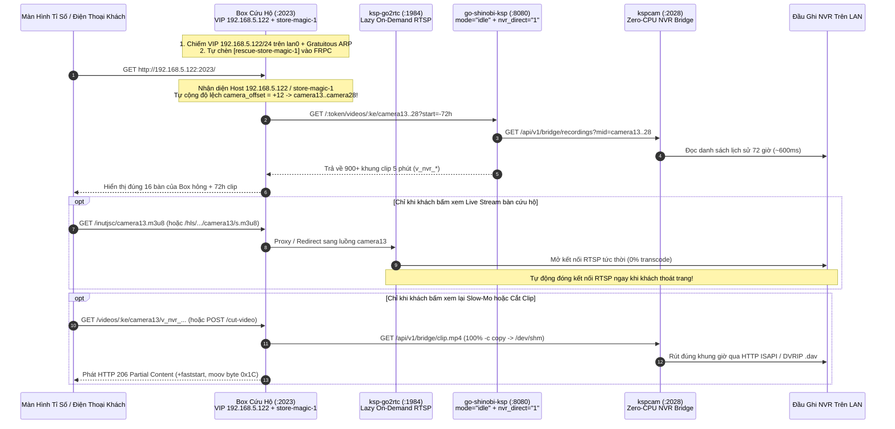

# PROTOCOL-BOX-RESCUE.md — Tính Năng Cứu Hộ Box Hỏng & Chạy Gánh Không Tải Nền (`Zero-Idle Box Rescue / Peer Failover Mode`)

> **Mục đích tài liệu:** Đặc tả kiến trúc, giao thức API/MCP 1-Click và cơ chế vận hành của tính năng **Cứu Hộ Box (`Box Rescue Mode`)** — cho phép một Edge Box khỏe mạnh tự động đứng ra gánh toàn bộ số bàn camera, màn hình tỉ số (`Cameralive`) và tên miền QR `4G` của một Box hỏng trong cùng CLB mà **không tốn CPU nền và không ghi đè thẻ nhớ (`0% Idle CPU`, `0` tiến trình `ffmpeg` nền)**.

---

## 1. Kiến Trúc & Luồng Hoạt Động (`Zero-Idle Failover`)



---

## 2. Năm Bất Biến Kỹ Thuật Sống Còn

1. **`0` Tiến Trình `ffmpeg` Nền & `0` Ghi Đè Thẻ Nhớ Cho Bàn Cứu Hộ**:
   - Toàn bộ các monitor cứu hộ (`camera13..camera28`) được lưu trên `go-shinobi-ksp` với `mode: "idle"` và `details.nvr_direct: "1"`.
   - Thẻ nhớ `/media/usb1` của Box cứu hộ tiếp tục dành `100%` dung lượng và băng thông ghi cho các bàn gốc của chính nó (`camera01..camera12`).
2. **Xem Trực Tiếp `100%` On-Demand Qua `go2rtc`**:
   - `sysworker.CompileGo2RTC` tự động đưa cả các monitor `mode: "idle"` vào `/root/go2rtc.yaml`. `go2rtc` chỉ mở socket RTSP khi có người xem thực sự và tự ngắt khi người xem rời đi.
3. **Bảo Toàn Thứ Tự Bàn Tuyệt Đối Từ File Backup Shinobi**:
   - Khi nạp file JSON backup (`monitorsJson`), bộ phân tích đọc hậu tố số của `mid` (`camera01` -> `1`, `camera05` -> `5`, `camera06` -> `6`... bất kể thứ tự xuất mảng SQLite bị xáo trộn) và giải mã mật khẩu gốc từ `details.auto_host` (tránh lỗi mật khẩu bị che `"••••••••"` trong `details.mpass`).
4. **Tự Động Thu Hồi Tên Miền QR `4G` (`FRPC Subdomain`) & Gratuitous ARP**:
   - `ApplyVirtualIPs` gắn IP ảo (ví dụ `192.168.5.122/24` trên `lan0`) và phát gói Gratuitous ARP để các máy tính bảng `Cameralive` chuyển mạch tức thì mà không phải khởi động lại màn hình.
   - `SyncFRPC` tự nối thêm block `[rescue-<subdomain>]` vào `/tmp/frpc.ini` (không làm bẩn khóa gốc `frpc_config`), khôi phục ngay lập tức toàn bộ mã QR in sẵn trên bàn cho khách dùng `4G`.
5. **Gỡ Cứu Hộ Sạch `100%` Khi Box Cũ Sửa Xong**:
   - Gọi `POST /api/rescue/deactivate` (hoặc MCP `kspcam_rescue_box` `action: "deactivate"`) lập tức nhả IP ảo `192.168.5.122`, xóa các kênh `rescueFrom` khỏi `go-shinobi-ksp` & `cameras.yaml` và biên dịch lại `go2rtc.yaml`.

---

## 3. Lệnh Kích Hoạt & Hủy Cứu Hộ 1-Click (`API` / `MCP`)

### 3.1 Kích hoạt cứu hộ qua MCP `kspcam_rescue_box` (hoặc `POST /api/rescue/activate`)
```json
{
  "action": "activate",
  "peerName": "inut_205_122",
  "iface": "lan0",
  "vip": "192.168.5.122/24",
  "frpcSubdomain": "store-magic-1",
  "publicSiteUrl": "http://store-magic-1.video.io.vn",
  "nvrHttpPort": 82,
  "monitorsJson": "[... nội dung file backup monitors_...json của box hỏng ...]"
}
```

### 3.2 Gỡ cứu hộ khi lắp lại Box mới (`POST /api/rescue/deactivate`)
```json
{
  "action": "deactivate",
  "peerName": "inut_205_122"
}
```

---

## 4. Số Liệu Thực Chiến: `5.123` Cứu Hộ Toàn Bộ `16` Bàn Của `5.122` (`Magic Arena Đà Nẵng`)

- **Bối cảnh**: Box `inut_205_122` (`192.168.5.122`, tên miền `store-magic-1.video.io.vn`, quản lý `16` bàn NVR kênh `3, 4, 17..30`) bị hỏng phần cứng. Box `inut_205_123` (`192.168.5.123`, đang chạy `12` bàn `camera01..camera12`) được kích hoạt cứu hộ.
- **Kết quả đo đạc thực tế trên `77.88.205.123`**:
  - **IP ảo trên `lan0`**: `192.168.5.123/24` (chính) + **`192.168.5.122/24` (cứu hộ)**.
  - **Tên miền QR `4G`**: `http://store-magic-1.video.io.vn/#!/0..15` từ trạng thái chết `404` sống lại ngay lập tức với đủ `16` bàn (`camera13..camera28`) và **`900` clip/bàn (`72 giờ`)**.
  - **Số tiến trình `ffmpeg` chạy nền**: Giữ nguyên **`12` tiến trình** (`0` tiến trình nền cho `16` bàn cứu hộ `camera13..camera28`), tổng RAM toàn máy chỉ **`463 MB / 1923 MB`**.
  - **Live Stream On-Demand**: `/inutjsc/camera13.m3u8` .. `/inutjsc/camera28.m3u8` trả `HTTP 200` (`HEVC 25fps`) ngay khi mở trang.
  - **Xem lại, Tua Slow-Mo & Cắt Clip bàn cứu hộ**: Tua Slow-Mo `14.19 ms`, cắt clip 90s hoàn tất trong **`8.23 giây`** (`0% CPU encode`), tải về tên chuẩn `inut_camera13_...`.
