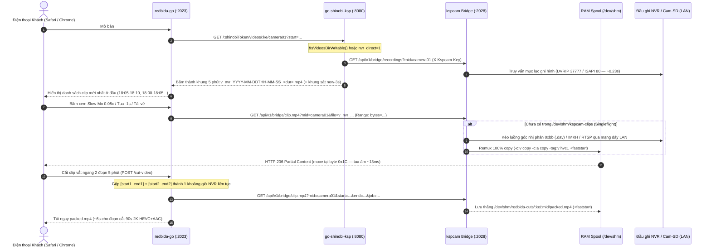

# PROTOCOL-NVR-BRIDGE.md — Kiến Trúc Cầu Nối NVR / Cam-SD Không Thẻ Nhớ (`Zero-CPU Copy`) Liên Thông `kspcam` ↔ `go-shinobi-ksp` ↔ `redbida-go`

> **Mục đích tài liệu:** Đặc tả kiến trúc, giao thức API nội bộ, cơ chế bộ đệm RAM `/dev/shm` và quy trình vận hành cho tính năng **Tự động Fallback sang ổ cứng Đầu ghi NVR / Thẻ nhớ trong Camera IP (`Zero-CPU NVR/Cam-SD Fallback Bridge`)** giữa bộ 3 dịch vụ thuần Go trên Edge Box iNut:
> - **`kspcam` (`:2028`)** — Giao thức nhị phân DVRIP / ISAPI / RTSP + Kho đệm RAM `/dev/shm/kspcam-clips`
> - **`go-shinobi-ksp` (`:8080`)** — Bộ băm khung 5 phút ảo (`Virtual 5-Minute Slicer`) + `Hybrid Merge`
> - **`redbida-go` (`:2023`)** — Giao diện người chơi, tua chậm Slow-Mo `0.05x–8x`, iOS Zoom & Cắt clip trực tiếp vào `/dev/shm/redbida-cuts`

---

## 1. Bài Toán Thực Địa & Triết Lý Thiết Kế

Trên đội thiết bị biên ARMv7 / ARM64 (RAM `1 GB – 4 GB`), có 3 tình huống thực tế cần hệ thống vẫn phục vụ đầy đủ danh sách highlight 5 phút, bấm **CheckVAR**, xem **Slow-Mo `0.05x–8x`** và **cắt/tải clip MP4 chuẩn iPhone Photos** mà không phụ thuộc vào thẻ nhớ `/media/usb1`:

1. **Chế độ Không Thẻ Nhớ (`Diskless / NVR-Direct`)**: Quán bida / sân Pickleball đã lắp sẵn đầu ghi Dahua / Hikvision / Tiandy / Raysharp có ổ cứng HDD `2 TB – 8 TB` trên cùng mạng dây LAN; Edge Box chạy không cần gắn thẻ nhớ ngoài `/media/usb1` (tiết kiệm chi phí phần cứng và loại bỏ hoàn toàn hao mòn thẻ nhớ).
2. **Tự chữa lành khi thẻ nhớ hỏng giữa ca (`Hybrid Failover`)**: Khi thẻ nhớ `/media/usb1` bất ngờ bị bad sector, rút lỏng hoặc chuyển sang Read-Only giữa giờ cao điểm, hệ thống tự động gộp (`Hybrid Merge`) các file `.mp4` cũ còn đọc được trên thẻ nhớ với các khung ảo `v_nvr_*` mới rút từ đầu ghi NVR — lịch sử xem lại liền mạch 100%.
3. **Camera IP lẻ tự gắn thẻ nhớ (`[Cam-SD]`)**: Với sân nhỏ lắp 1–2 camera IP có thẻ microSD riêng mà không dùng NVR, hệ thống tự nhận diện nguồn `isCamSd: true` và khóa cứng 1 luồng kéo tuần tự để bảo vệ chip nhớ của camera.

### 4 Bất Biến Kỹ Thuật Sống Còn (Inviolable Invariants)

1. **CẤM TUYỆT ĐỐI Encode Bằng CPU Trên Box (`0% CPU Encode` — `100% Stream Copy`)**:
   - Toàn bộ lệnh `ffmpeg` trong `bridge.go`, `fastmp4.go` và `cutter/bridge_cut.go` bắt buộc chạy **`-c:v copy`** kết hợp **`-c:a copy`**.
   - Nếu luồng âm thanh gốc trên đầu ghi là G.711 (`pcm_alaw` / `pcm_mulaw`) không tương thích container MP4, hệ thống tự động thử lại ngay bằng **`-c:v copy -an`** (`0% CPU`), **tuyệt đối không bao giờ gọi `libx264`, `libx265` hay `-c:a aac`** để bảo vệ CPU ARM không bao giờ quá tải hay treo máy.
2. **Chuẩn MP4 `+faststart` & `hvc1` Ngay Tại Byte `0x1C` Đầu File**:
   - Không xả thô luồng fragmented `empty_moov` cho khách tải về (do `duration=0` làm iPhone Photos từ chối cho *"Lưu Video"* và gây khựng khi tua `0.05x`).
   - Toàn bộ clip được đóng gói hoàn chỉnh với `-tag:v hvc1 -movflags +faststart` vào RAM `/dev/shm` trong vài giây qua mạng dây LAN rồi phục vụ qua `http.ServeContent` (`HTTP 206 Partial Content`, `Accept-Ranges: bytes`).
3. **Không Ghi Lên Bộ Nhớ Boot eMMC `/` Khi Vắng Thẻ Nhớ**:
   - Khi `/media/usb1` không phải là phân vùng ngoài đang mount (`!IsVideosDirWritable()`), mọi file đệm xem lại và file cắt `packed.mp4` chỉ nằm trong `tmpfs` RAM (`/dev/shm/kspcam-clips` và `/dev/shm/redbida-cuts`) kèm cơ chế tự xóa theo dung lượng LRU và TTL.
4. **Không Lộ Mật Khẩu Đầu Ghi & Không Cần NAT Port NVR Ra Internet**:
   - Khác với kiến trúc ứng dụng di động phải mở port HTTP/RTSP đầu ghi ra WAN và trả mật khẩu NVR xuống máy khách, toàn bộ thông tin đăng nhập NVR được mã hóa `AES-256-GCM` kín bên trong Edge Box; các dịch vụ chỉ nói chuyện với nhau qua loopback `127.0.0.1` kèm header `X-Kspcam-Key`.

---

## 2. Sơ Đồ Luồng Dữ Liệu Tổng Thể



---

## 3. Đặc Tả Kỹ Thuật Trên Từng Thành Phần

### 3.1 `kspcam (:2028)` — `internal/server/bridge.go` & `internal/dahua/davdownload.go`

1. **Nhóm Endpoint Cầu Nối Nội Bộ**:
   - `GET /api/v1/bridge/status`: Trả trạng thái hoạt động, dung lượng `/dev/shm/kspcam-clips` đang dùng / tối đa, chế độ `lowRamMode`, và bảng ánh xạ `mid (camera01..camera30) -> (sourceId, sourceHost, vendor, channel, isCamSd)`.
   - `GET /api/v1/bridge/recordings?mid=camera01&start=...&end=...`: Truy vấn danh sách phân đoạn ghi hình trên NVR hoặc thẻ nhớ camera (có cache RAM `10s` + `singleflight` để chống dồn phiên đăng nhập khi nhiều khách cùng mở trang).
   - `GET /api/v1/bridge/clip.mp4?mid=camera01&file=v_nvr_...` (hoặc `&start=...&end=...&download=0|1&job=...`): Hợp nhất các request trùng lặp bằng `singleflight`, trích xuất + remux `-c copy` vào `/dev/shm/kspcam-clips/<sha1>.mp4`, ghim (`pin`) file trong suốt thời gian truyền và phục vụ qua `http.ServeContent` (`HTTP 206 Partial Content`).
   - `POST /api/v1/bridge/flush-cache`: Xóa tức thì cache danh sách ghi hình 10 giây khi người chơi bấm nút **CheckVAR**.

2. **Đường Ống Rút Luồng Tốc Độ Cao Theo Từng Hãng (`100% -c copy`)**:
   - **Dahua / KBVision NVR (`VendorDahua`)**:
     - *Đường chính*: Tải nhị phân `0xbb` (`.dav` DHAV) trực tiếp qua cổng TCP `37777`/`8888` (`dahua.StreamDav`), sau đó đóng gói `ffmpeg -f dhav -i raw.dav -c:v copy -c:a copy -tag:v hvc1 -movflags +faststart`.
     - *Tối ưu `davStreamIdle = 2.2s` (`davdownload.go`)*: Tách biệt bộ đếm thời gian của gói media `0xbb` khỏi gói echo keepalive `0xa1` (`800ms`), giúp việc rút 5 phút con từ một file `.dav` 1 tiếng đang ghi dở kết thúc dứt khoát ngay khi đủ dữ liệu thay vì bị treo chờ timeout.
     - *Đường dự phòng*: Nếu cổng cấu hình `37777` bận, tự động chuyển sang kéo RTSP Playback song song (`mediaexport.FastMP4Range`, `parallel = 4`, có retry tuần tự từng khúc nếu rớt).
   - **Hikvision NVR & `[Hik-SD]` (`VendorHikvision`)**:
     - *Đường chính trên NVR HTTP*: Tìm phân đoạn qua ISAPI `SearchTrack`; nếu tổng dung lượng phân đoạn chồng lấn vừa khít ngưỡng an toàn RAM (`<= 42 MB` trên box 1GB, `<= 85 MB` trên box 2GB+), tải thẳng luồng gốc `IMKH` qua `/ISAPI/ContentMgmt/download` rồi cắt/remux `-c copy +faststart`.
     - *Đường RTSP thông minh*: Nếu NVR đóng gói 1 cục lớn hàng trăm MB hoặc kết nối qua cổng 8000, tự động dùng `FastMP4Range` (`parallel = 4` cho NVR; **khóa cứng `parallel = 1` tuần tự cho camera cắm thẻ nhớ lẻ `isCamSd == true`**).
   - **Chuẩn hóa cờ màu VUI `yuvj420p` không tốn CPU**:
     - Kiểm tra nhanh bằng `ffprobe`; chỉ khi phát hiện luồng `color_range == "pc"` (`yuvj420p`) mới chạy bitstream filter sửa header SPS (`hevc_metadata` / `h264_metadata` với `-c copy`, `0%` giải mã/mã hóa) để chống lóa sáng trên màn hình OLED iPhone.

3. **Bảo Vệ Tài Nguyên (`Zero-Overload Guard`)**:
   - **Semaphore theo địa chỉ IP đầu ghi**: Tối đa `max_per_nvr: 2` tác vụ rút video đồng thời trên mỗi đầu ghi NVR (riêng `isCamSd` khóa cứng `1`).
   - **Kho đệm LRU `/dev/shm/kspcam-clips`**: Tự động nhận diện dung lượng RAM vật lý (`/proc/meminfo`): giới hạn **`120 MB`** trên box RAM `1 GB` (thời lượng clip tối đa `10 phút`) và **`240 MB`** trên box RAM `>= 2 GB` (thời lượng clip tối đa `20 phút`), tự động dọn các file quá `10 phút` (`clip_ttl_seconds: 600`).

---

### 3.2 `go-shinobi-ksp (:8080)` — `internal/server/nvr_bridge.go`

- **Tự Động Kích Hoạt (`shouldMergeVirtualNVR`)**:
  - Kích hoạt ngay khi `!s.engine.IsVideosDirWritable()` (box không gắn thẻ nhớ `/media/usb1` hoặc thẻ nhớ lỗi I/O), hoặc khi monitor cấu hình `nvr_direct = "1"`, hoặc khi danh sách video cục bộ bị đứt quãng `> 10 phút` (cho phép **Hybrid Merge**).
  - Khi thẻ nhớ `/media/usb1` đang hoạt động khỏe mạnh bình thường, hàm trả `false` ngay lập tức (`0` truy vấn phụ sang NVR).
- **Quy Ước Tên File Ảo (`Virtual 5-Minute Slicer`)**:
  - Băm các khoảng ghi hình thực tế trên NVR theo mốc đồng hồ chẵn 5 phút (`00, 05, 10, ..., 55`), sinh mã định danh:
    `v_nvr_YYYY-MM-DDTHH-MM-SS_<durSec>.mp4` (ví dụ: `v_nvr_2026-11-08T18-00-00_300.mp4`).
  - Khung 5 phút mới nhất đang diễn ra được tính sát tới **`now - 3 giây`** (ví dụ: `v_nvr_2026-11-08T18-05-00_172.mp4`), giúp nút **CheckVAR** cập nhật ngay pha bóng vừa diễn ra mà không cần chạy `date -s`.

---

### 3.3 `redbida-go (:2023)` — `internal/server/nvr_bridge.go` & `internal/cutter/bridge_cut.go`

- **Phát Trực Tiếp `HTTP 206 Byte-Range` Qua Cổng `:2023`**:
  - Khi gặp đường dẫn `/videos/:ke/:mid/v_nvr_...mp4`, `redbida-go` proxy thẳng sang `127.0.0.1:2028/api/v1/bridge/clip.mp4` kèm toàn bộ header `Range` / `If-Range` / `Content-Range` thay vì redirect `303` sang cổng `:8080`. Nhờ đó tên miền công khai qua FRPC (`http://store-*.video.io.vn`) phát mượt Slow-Mo `0.05x–8x`, Zoom iOS và tải clip về máy mà không cần mở cổng `:8080` ra ngoài.
- **Gộp Khoảng Cắt Liên Tiếp Trong `cutter/bridge_cut.go`**:
  - Khi người chơi kéo chọn đoạn cắt vắt qua 2 khung 5 phút liên tiếp (ví dụ `225s..300s` của khung trước nối với `0s..15s` của khung sau = `90s`), hàm `mergeContiguousSpans` tự động gộp thành **1 khoảng thời gian duy nhất** và yêu cầu `kspcam` rút đúng `90 giây` đó từ NVR vào `/dev/shm/redbida-cuts/<ke>/<mid>/packed.mp4` (tự động xóa sau `12 phút`).

---

## 4. Cấu Hình Chuẩn & Triển Khai Ansible 1-Click

Bộ 3 playbook trên máy chủ Ansible `172.16.5.180` (`/build/armbian-build/ansible`) đã tích hợp sẵn cấu hình cầu nối mặc định:

```bash
cd /build/armbian-build/ansible

# 1. Cài đặt / cập nhật kspcam (:2028) kèm cấu hình bridge:
make ksp-cam <ten_node>

# 2. Cài đặt / cập nhật go-shinobi-ksp (:8080) bật sẵn nvr_direct_fallback:
make go-shinobi <ten_node>

# 3. Cài đặt / cập nhật redbida-go (:2023) nối sẵn cut_spool_dir /dev/shm:
make redbida-go <ten_node>
```

Đối với các CLB dùng đầu ghi NVR nơi camera con trong `cameras.yaml` chưa gắn liên kết kênh đầu ghi, quản trị viên chỉ cần mở `kspcam (:2028)` -> **Quét NVR (`/api/nvr/scan`)** -> **Lưu liên kết (`/api/nvr/link`)** một lần duy nhất.

---

## 5. Số Liệu Kiểm Chứng Thực Tế Trên `inut_202_222` (`Fox Billiards & Coffee Hội An`)

Cấu hình phần cứng thực tế: Chip `armv7l` 32-bit (`Linux 5.15.93-sunxi`), RAM `999 MB`, **không gắn thẻ nhớ `/media/usb1`**, kết nối mạng dây LAN tới đầu ghi **Dahua 8 kênh `DHI-NVR1108HS-S3/H-VN` (`192.168.1.243:37777`)** ghi hình độ phân giải **`2560x1440` (2K HEVC + AAC)**:

- **Truy vấn danh sách clip 72 giờ (`866` khung 5 phút)**: `~1.1s` (lần đầu) / `< 15ms` (từ cache 10s).
- **Bấm nút CheckVAR không thẻ nhớ**: `1.03s` (lên ngay clip mới nhất sát `now - 3s`, không cần `date -s`).
- **Mở xem lần đầu trọn bộ clip 5 phút (`299.9s`, nặng `49.84 MB`)**: `13.45s` (`HTTP 206`, `moov` nằm ngay byte `0x1C`, `codec_tag = hvc1`, `aac = mp4a`).
- **Tua Slow-Mo `0.05x–8x` / nhảy `-1s`, `+1s` trên clip đang xem**: **`13.01 ms`** từ RAM `/dev/shm`.
- **Cắt clip `90 giây` vắt ngang 2 khung 5 phút (`/cut-video` -> `packed.mp4`, `14.98 MB`)**: Hoàn tất `100%` trong **`6.02 giây`**.
- **Tài nguyên tiêu thụ trên Box 1GB RAM**: `load average = 0.58` (`0%` CPU khi nghỉ), RAM tiến trình `camera = 11.3 MB`, `inut = 27.1 MB`, `/dev/shm` tự giới hạn an toàn dưới `120 MB`.
