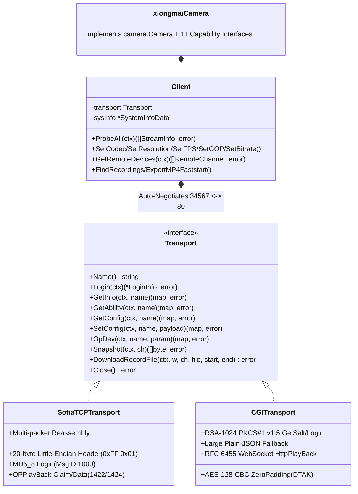

# Đặc Tả Giao Thức Xiongmai (`internal/xiongmai` — Sofia TCP 34567 & HTTP CGI/WS 80)

Tài liệu đặc tả kiến trúc hướng đối tượng thuần Go (`CGO_ENABLED=0`) cho hệ sinh thái Camera IP và Đầu ghi DVR/HVR/NVR của **Hangzhou Xiongmai Technology (XM / XMEye / iCSee / Vitacam / JFTech / Sofia)** trong `kspcam`.

---

## 1. Kiến Trúc Hướng Đối Tượng Đa Tầng Giao Vận (`Transport` Strategy Pattern)

Thực tế triển khai tại hiện trường (ví dụ node `inut_208_4` — Nhà Yến Anh Hùng Gò Vấp) tồn tại song song 2 thế hệ firmware Xiongmai:
- **Camera IP độc lập 8MB Flash (Vitacam / iCSee / XMEye)**: Chỉ mở giao thức nhị phân **Sofia DVRIP trên TCP `34567`** (`MD5_8`), cổng HTTP `80` tắt hoặc chỉ chứa bootstrap rỗng.
- **Đầu ghi HVR/NVR đời mới (bật bảo mật RSA)**: Từ chối đăng nhập `MD5_8` trần trên cổng `34567` với mã **`Ret = 205` (`ERR_RSA_REQUIRED`)**, đồng thời cung cấp đầy đủ REST CGI mã hóa **RSA-1024 + `AES-128-CBC` ZeroPadding** và WebSocket nhị phân trên cổng `80`.

Package `internal/xiongmai` tách bạch hoàn toàn tầng giao vận thông qua interface `xiongmai.Transport`:

### Quy tắc Đàm phán Tự động (`Client.Transport`)
1. Khi cổng cấu hình là `34567` (mặc định `xiongmai_port: 34567`): Thử `SofiaTCPTransport(:34567)` trước. Nếu thiết bị trả `Ret == 205` (`ErrRSAHandshakeRequired`) hoặc không mở `34567`, tự động chuyển sang `CGITransport(:80)`.
2. Khi cổng cấu hình là `80` (hoặc cổng HTTP tùy biến): Thử `CGITransport` trước; nếu timeout / `404` (như trên các mắt cam lẻ), tự động chuyển sang `SofiaTCPTransport(:34567)`.
3. **Chống khóa tài khoản (`Ret = 206`)**: Nếu tầng thứ nhất trả về `ErrAuthFailed` (`Ret = 106 / 203` — sai mật khẩu), `Client` dừng ngay lập tức, tuyệt đối không thử lại trên tầng thứ hai để tránh tốn gấp đôi số lần thử sai.

---

## 2. Đặc Tả Mật Mã & Quy Đổi Tham Số Đặc Thù

1. **Hàm băm `MD5_8`**:
   - Với `digest = MD5(password)` (16 bytes), tính `r[i] = (digest[2*i] + digest[2*i+1]) % 62` với `i = 0..7` và ánh xạ vào `0-9` (`0..9`), `A-Z` (`10..35`), `a-z` (`36..61`).
2. **Đăng nhập CGI RSA + Phiên `AES-128-CBC` ZeroPadding**:
   - `Sign = RSA_PKCS1v15_Hex(OEMHeader + Salt + hex_md5_lower(password))`
   - `DTAK = RSA_PKCS1v15_Hex(aesKey16)` (IV gồm 16 byte `0x00`, đệm byte `0x00` cuối chuỗi).
3. **Định dạng `MainFormat` / `ExtraFormat` kép & Kênh IP `bypass@`**:
   - Tự động đọc/ghi cả định dạng đối tượng `{...}` (HVR/CGI) lẫn mảng 1 phần tử `[{...}]` (IPC Sofia).
   - Trên đầu ghi HVR/NVR khi `ch >= VideoInChannel`, tự động định tuyến sang `bypass@AVEnc.Encode.[ch - VideoInChannel]`.
4. **Quy đổi `GOP` (Giây $\leftrightarrow$ Frames) & IP Hex Little-Endian**:
   - Xiongmai lưu `Video.GOP` theo **giây (`1..12s`)** thay vì số frame: `kspcam` tự động nhân `FPS` khi `Probe` và chia `round(gopFrames / fps)` khi `Apply`.
   - Địa chỉ IP trong `NetWork.NetCommon` lưu dạng Hex Little-Endian (`"0x8A4DA8C0"` $\leftrightarrow$ `"192.168.77.138"`).
5. **Đường dẫn RTSP Chuẩn & Zero-CPU Playback Bridge**:
   - RTSP: `rtsp://<user>:<pass>@<host>:554/user=<user>_password=<pass>_channel=<1..N>_stream=<0|1>.sdp?real_stream`
   - Tách vỏ khung media Xiongmai (`00 00 01 FC/FE/FD/FA`) thành luồng H.264/H.265 Annex-B sạch và đóng gói MP4 `+faststart` với `-c:v copy -an` (`0% CPU` transcode).
6. **Tự động giải mã `GetRandomUser` (`admin` $\to$ `admin1`) & Tương thích `uc-httpd 1.0.0`**:
   - Trên firmware Xiongmai đời mới (`V4.03.R11.C6380233`, `BuildTime: 2023-04-14`), tên tài khoản `admin`, `root`, `system`, `guest`, `administrator` bị chặn cứng bởi quy tắc `IDS_ACC_InvalidUserName` (`Ret = 101`). Khi cấu hình `username: "admin"`, `CGITransport` tự động gọi `/cgi-bin/resetpwd.cgi` (`GetDevInfo` lấy `SerialNo` + `GetRandomUser` lấy `Info`), giải mã `AES-128-CBC` ZeroPadding với khóa `key = SerialNo[5:11] + SerialNo[1:7] + SerialNo[8:12]` để lấy tên tài khoản quản trị thực tế (`p1:admin1 p2:101 t:...` $\to$ `admin1`) trước khi gọi `Login`.
   - Web server nhúng `uc-httpd 1.0.0` trên đầu ghi trả dòng header đầu tiên có dấu cách thừa (`" Content-type: text/plain\r\n"`). `doXiongmaiHTTP` tự động fallback sang raw `HTTP/1.0` (`doRawHTTP10`) khi `net/http` báo lỗi `malformed MIME header initial line`.

---

## 3. Hồ Sơ Thiết Bị Thực Tế Tại Node `inut_208_4` (Nhà Yến Anh Hùng Gò Vấp)

### 3.1 Thông Tin Đầu Ghi & Tài Khoản Quản Trị (`192.168.77.138`)
- **Model / Phần cứng:** `NBD80S16S-KL` (`16` kênh IP `DigChannel: 16`, `VideoInChannel: 0`)
- **Firmware:** `V4.03.R11.C6380233.12201.140000.0000000` (Build `2023-04-14 13:11:09`)
- **SerialNo:** `c1beba4793bccbdapnx9` (Khóa AES `GetRandomUser`: `a4793b1beba493bc`)
- **MAC:** `00:12:43:aa:de:9e` · **Cổng:** HTTP `80`, Sofia TCP `34567`, RTSP `554`
- **Ổ cứng (`StorageInfo`):** `0x000E8E0D` ($\approx 953.8\text{ GB}$ / $1\text{ TB}$), đang ghi hình bình thường (`Status: 0`).
- **Danh sách tài khoản quản trị (Group `admin`, đủ 55 quyền + đồng bộ `System.ExUserMap` cho RTSP `:554`):**

| Vai trò | Username | Password | Băm `MD5_8` | Mã `System.ExUserMap` | Ghi chú |
|---|---|---|---|---|---|
| **Admin chính (`RandomUser`)** | `admin1` | `Inut12345` | `IgCDPz7Q` | `00111W51dDEyMzQS` | Tự động điền trên Web UI & tự động ánh xạ khi `kspcam` cấu hình `username: admin` |
| **Admin dự phòng (Backup)** | `admin2` | `Inut12345` | `IgCDPz7Q` | `00111W51dDEyMzQS` | Tài khoản dự phòng đồng bộ mật khẩu `Inut12345` (55 quyền + RTSP `:554`) |
| **Admin nội bộ / HDMI** | `pymid` | `pymid123` | `vg22TaVl` | `0011=cHltaWQxMjN` | Tài khoản `AutoLogin` trên màn hình HDMI cục bộ (`Memo: "admin 's account"`) |

### 3.2 Bảng Kênh Camera IP Con Trên Đầu Ghi `192.168.77.138` (`NetWork.RemoteDeviceV3`)

| Kênh | Tên | Trạng thái | Độ phân giải | IP Camera con | Cổng / Giao thức | User | Password | Đường dẫn RTSP Main Stream |
|---|---|---|---|---|---|---|---|---|
| **CH01** | `D01` | `Connected` | `1080P/D1` | `192.168.77.71` | `554` / `RTSP` | `admin` | `pymid123` | `rtsp://192.168.77.71:554/0` |
| **CH02** | `D02` | `Offline` | `Unknown` | `192.168.77.218` | `554` / `RTSP` | `admin` | `pymid123` | `rtsp://192.168.77.218:554/Streaming/Channels/0` |
| **CH03** | `D03` | `Connected` | `1080P/704x576` | `192.168.77.34` | `554` / `RTSP` | `admin` | `tranhung1591984` | `rtsp://192.168.77.34:554/user=admin_password=tranhung1591984_channel=1_stream=0.sdp?real_stream` |
| **CH04** | `D04` | `Connected` | `1080P/720x576` | `192.168.77.146` | `554` / `RTSP` | `admin` | `admin` | `rtsp://192.168.77.146:554/0` |
| **CH05** | `D05` | `Connected` | `1080P/D1` | `192.168.77.178` | `554` / `RTSP` | `admin` | `admin` | `rtsp://192.168.77.178:554/0` |
| **CH06** | `D06` | `Connected` | `1080P/VGA` | `192.168.77.160` | `554` / `RTSP` | `admin` | `L2E8D64D` | `rtsp://192.168.77.160:554/cam/realmonitor?channel=1&subtype=0` |
| **CH07** | `D07` | `Connected` | `1080P/704x576` | `192.168.77.65` | `554` / `RTSP` | `admin` | `pymid123` | `rtsp://192.168.77.65:554/user=admin_password=pymid123_channel=1_stream=0.sdp?real_stream` |
| **CH08** | `D08` | `Connected` | `1080P/QVGA` | `192.168.77.205` | `554` / `RTSP` | `admin` | `tranhung159` | `rtsp://192.168.77.205:554/Streaming/Channels/101` |
| **CH09** | `D09` | `Connected` | `1080P/VGA` | `192.168.77.84` | `554` / `RTSP` | `admin` | `L21ACFE9` | `rtsp://192.168.77.84/cam/realmonitor?channel=1&subtype=0&unicast=true&proto=Onvif` |
| **CH10** | `D10` | `Connected` | `1080P/VGA` | `192.168.77.147` | `554` / `RTSP` | `admin` | `L2B74148` | `rtsp://192.168.77.147:554/cam/realmonitor?channel=1&subtype=0` |
| **CH11** | `D11` | `Offline` | `Unknown` | `192.168.77.98` | `554` / `RTSP` | `admin` | `tranhung159` | `rtsp://192.168.77.98:554/user=admin_password=tranhung159_channel=1_stream=0.sdp?real_stream` |
| **CH12–16** | `D12–16` | `NoConfig` | — | — | — | — | — | *(Chưa gán kênh)* |
