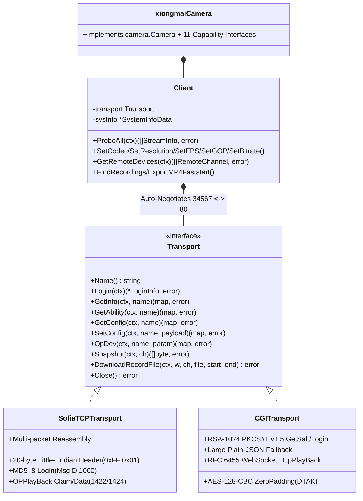

# Đặc Tả Giao Thức Xiongmai (`internal/xiongmai` — Sofia TCP 34567 & HTTP CGI/WS 80)

Tài liệu đặc tả kiến trúc hướng đối tượng thuần Go (`CGO_ENABLED=0`) cho hệ sinh thái Camera IP và Đầu ghi DVR/HVR/NVR của **Hangzhou Xiongmai Technology (XM / XMEye / iCSee / Vitacam / JFTech / Sofia)** trong `kspcam`.

---

## 1. Kiến Trúc Hướng Đối Tượng Đa Tầng Giao Vận (`Transport` Strategy Pattern)

Thực tế triển khai tại hiện trường (ví dụ node `inut_208_4` — Nhà Yến Anh Hùng Gò Vấp) tồn tại song song 2 thế hệ firmware Xiongmai:
- **Camera IP độc lập 8MB Flash (Vitacam / iCSee / XMEye)**: Chỉ mở giao thức nhị phân **Sofia DVRIP trên TCP `34567`** (`MD5_8`), cổng HTTP `80` tắt hoặc chỉ chứa bootstrap rỗng.
- **Đầu ghi HVR/NVR đời mới (bật bảo mật RSA)**: Từ chối đăng nhập `MD5_8` trần trên cổng `34567` với mã **`Ret = 205` (`ERR_RSA_REQUIRED`)**, đồng thời cung cấp đầy đủ REST CGI mã hóa **RSA-1024 + `AES-128-CBC` ZeroPadding** và WebSocket nhị phân trên cổng `80`.

Package `internal/xiongmai` tách bạch hoàn toàn tầng giao vận thông qua interface `xiongmai.Transport`:

### Quy tắc Đàm phán Tự động (`Client.Transport`)
1. Khi cổng cấu hình là `34567` (mặc định `xiongmai_port: 34567`): Thử `SofiaTCPTransport(:34567)` trước. Nếu thiết bị trả `Ret == 205` (`ErrRSAHandshakeRequired`) hoặc không mở `34567`, tự động chuyển sang `CGITransport(:80)`.
2. Khi cổng cấu hình là `80` (hoặc cổng HTTP tùy biến): Thử `CGITransport` trước; nếu timeout / `404` (như trên các mắt cam lẻ), tự động chuyển sang `SofiaTCPTransport(:34567)`.
3. **Chống khóa tài khoản (`Ret = 206`)**: Nếu tầng thứ nhất trả về `ErrAuthFailed` (`Ret = 106 / 203` — sai mật khẩu), `Client` dừng ngay lập tức, tuyệt đối không thử lại trên tầng thứ hai để tránh tốn gấp đôi số lần thử sai.

---

## 2. Đặc Tả Mật Mã & Quy Đổi Tham Số Đặc Thù

1. **Hàm băm `MD5_8`**:
   - Với `digest = MD5(password)` (16 bytes), tính `r[i] = (digest[2*i] + digest[2*i+1]) % 62` với `i = 0..7` và ánh xạ vào `0-9` (`0..9`), `A-Z` (`10..35`), `a-z` (`36..61`).
2. **Đăng nhập CGI RSA + Phiên `AES-128-CBC` ZeroPadding**:
   - `Sign = RSA_PKCS1v15_Hex(OEMHeader + Salt + hex_md5_lower(password))`
   - `DTAK = RSA_PKCS1v15_Hex(aesKey16)` (IV gồm 16 byte `0x00`, đệm byte `0x00` cuối chuỗi).
3. **Định dạng `MainFormat` / `ExtraFormat` kép & Kênh IP `bypass@`**:
   - Tự động đọc/ghi cả định dạng đối tượng `{...}` (HVR/CGI) lẫn mảng 1 phần tử `[{...}]` (IPC Sofia).
   - Trên đầu ghi HVR/NVR khi `ch >= VideoInChannel`, tự động định tuyến sang `bypass@AVEnc.Encode.[ch - VideoInChannel]`.
4. **Quy đổi `GOP` (Giây $\leftrightarrow$ Frames) & IP Hex Little-Endian**:
   - Xiongmai lưu `Video.GOP` theo **giây (`1..12s`)** thay vì số frame: `kspcam` tự động nhân `FPS` khi `Probe` và chia `round(gopFrames / fps)` khi `Apply`.
   - Địa chỉ IP trong `NetWork.NetCommon` lưu dạng Hex Little-Endian (`"0x8A4DA8C0"` $\leftrightarrow$ `"192.168.77.138"`).
5. **Đường dẫn RTSP Chuẩn & Zero-CPU Playback Bridge**:
   - RTSP: `rtsp://<user>:<pass>@<host>:554/user=<user>_password=<pass>_channel=<1..N>_stream=<0|1>.sdp?real_stream`
   - Tách vỏ khung media Xiongmai (`00 00 01 FC/FE/FD/FA`) thành luồng H.264/H.265 Annex-B sạch và đóng gói MP4 `+faststart` với `-c:v copy -an` (`0% CPU` transcode).
